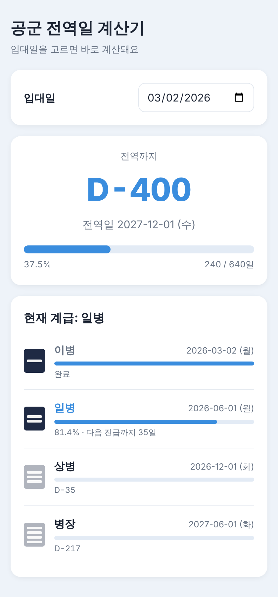

# 🛫 공군 전역일 계산기

입대일을 고르면 전역일, D-day, 계급별 진급일을 한눈에 보여주는 웹 페이지입니다.

**👉 [사이트 바로가기](https://hotmericano.github.io/dday-calculator/)**

## 주요 기능

- **전역일 & D-day**: 입대일 기준 전역일과 남은 일수 표시
- **전체 복무 진행률**: 복무 일수와 퍼센트를 진행률 바로 표시
- **계급별 진급일**: 일병·상병·병장 진급일과 계급별 진행률 표시
- **약장 표시**: CSS로 그린 계급 약장 (이병 1줄 ~ 병장 4줄)
- **입대일 기억하기**: 한 번 고른 입대일을 브라우저에 저장해서 다음에 바로 계산
- **다크 모드 지원**, 휴대폰 화면 대응

## 계산 기준

| 항목 | 기준 |
|---|---|
| 복무 기간 | 21개월 (공군) |
| 전역일 | 입대일 + 21개월의 같은 날짜 전날 (해당 날짜가 없으면 그 달 말일) |
| 진급 기간 | 이병 2개월 → 일병 6개월 → 상병 6개월 → 병장 |
| 진급일 | 매월 1일. 1일 입대는 입대일부터, 그 외에는 다음 달 1일부터 기간 계산 |

> 실제 진급일은 조기진급, 진급 누락 등에 따라 달라질 수 있습니다.

## 기술 스택

- HTML, CSS, JavaScript (라이브러리 없이 순수 JS)
- GitHub Pages 배포

## 파일 구조
dday-calculator/
├── index.html # 화면 구조
├── style.css # 디자인 (라이트/다크 모드)
└── main.js # 날짜 계산, 화면 그리기, 입대일 저장

## 개발 과정

이슈로 할 일을 나누고, 버전마다 브랜치 → PR → 리뷰 → 머지 순서로 개발했습니다.

| 버전 | 내용 | PR |
|---|---|---|
| v0.1 | 전역일과 D-day 계산 | #6 |
| v0.2 | 계급별 진급일과 약장 표시 | #9 |
| v0.4 | 진행률 바, 디자인 개선 | #10 |
| v1.0 | GitHub Pages 배포 | - |
| v1.1 | 입대일 기억하기 | #12 |

- v0.3 (기수로 입대일 자동 계산)은 공식 기수별 입영일 자료가 없어 보류했습니다. (#3)

## 배운 점

- **Git 협업 흐름**: 이슈, 브랜치, 커밋 메시지 규칙(`feat`, `fix`), PR과 `closes #번호`로 이슈 자동 종료
- **머지 충돌 해결**: 같은 파일을 동시에 수정해 생긴 충돌 표시(`<<<<<<<`)를 정리하고 수정 PR로 복구 (#7)
- **날짜 계산의 함정**: `new Date("2026-01-05")`는 UTC 기준으로 해석되어 날짜가 밀릴 수 있어, 직접 나눠서 로컬 날짜로 생성
- **localStorage**: 서버 없이 브라우저에 데이터를 저장하는 방법
